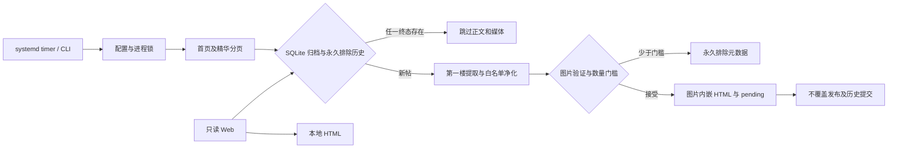

# 单脚本架构

生产代码全部在 `discuz_archive.py`，仅依赖 Python 3.11+ 标准库；配置为 TOML，不打包构建，无编译产物。测试与原型独立于生产入口。

## 模块职责

- `Config`：相对路径以配置目录为基准，限制请求参数及简单广告选择器。
- `Client`：真实 urllib HTTP 会话、Cookie 域隔离、限速、有限重试、robots 检查、响应体上限；线程独立 opener、共享 CookieJar 会话与锁保护的限速及 robots 缓存，不执行页面脚本或绕过验证。
- `ImageWindow`：每帖有界线程池预取，默认4路、最多8路；按正文顺序消费 future 并推进窗口，保留图片顺序，控制中间结果缓冲。过滤后才预下载，不下载回复、广告或权限块；图片计数与SQLite写入仍在主线程完成。
- `Document` / `Node`：标准库 HTMLParser 构建受深度限制的树；不尝试实现任意 CSS 引擎。
- URL 与分页函数：支持 classic、X 和常见伪静态链接。精华依据行内标记或服务器渲染的活动筛选状态；stock 精华页会隐藏图标。无图标置顶通过同板块普通列表另行核验，未知置顶不归档并报告未完整。
- `Cleaner` / `extract_post`：仅第一楼，标签/属性白名单、去交互及广告、原字节图片内嵌；启用 min_images 后隔离单图失败，按不同成功图片源数量决定接受或永久排除，受限图片不请求。格式魔数与基本完整性校验不等同于完整图片解码。
- `Store`：SQLite 成功/永久排除双终态、输出身份、不可覆盖发布、pending 恢复及 v1→v2 事务迁移。契约详见 `DATABASE.md`。
- Web：标准库只读服务、分页列表与按记录 ID 阅读，文件流式响应；没有用户输入的抓取接口。
- 子路径部署：web.base_path默认空；显式配置时内部strip前缀，生成链接、分页和PWA资源均使用前缀，保留裸路由供本机兼容检查。精确前缀308到尾斜杠，所有内容依旧鉴权。SW缓存以base_path摘要隔离，不清除同源其它实例缓存。
- systemd：独立日常 oneshot、timer 与可选阅读 service；只有 install/uninstall 修改系统状态。

## 读写及诊断

Web 页面不执行源站请求，不更新归档，不重算内容。只读 SQLite 连接按请求关闭；归档 HTML 直接从本地流式发送。默认回环监听，远程绑定需要 token 文件，Basic 认证用户名 `archive`；TLS 交由反向代理。

`/api/debug/state` 返回归档、永久排除、pending 数量、版本、最后一次运行统计，以及 `current_run` 实时进度。数据库计数带五秒缓存与互斥，current_run 每次读取轻量本地原子快照，不发起外部请求，不输出源站 URL、Cookie 或私有路径。`--check` 只读验证完整历史和文件摘要，不做补抓。永久排除不视作运行错误，未知模板/整页临时网络问题仍保持可重试错误。

进度保存在数据库旁 `progress.json`，以临时文件+原子替换发布，线程互斥。包括 pid、trace、UTC时间、status/phase、fid/tid、image_attempts/available/failed、download_total/completed/failed 与累计统计。下载计数为网络任务完成数，图片计数为正文实际保留的不同图片源数；多帧GIF计一图。死亡进程的 running 快照只读解释为 interrupted。已结束状态不因进程退出改写。

安装访问探针在真实服务账号下检查文件读取、解释器执行、父目录穿行及状态写入。若目标解释器不可启动，可用系统Python只读诊断路径，但不能以备用解释器的成功误判原解释器可运行。只格式化结构化失败路径，不回显 launcher stdout/stderr 或敏感文件内容；诊断结果只进入本地安装日志，不进入Web接口。

systemd的ExecStart参数使用word quoting，WorkingDirectory单路径指令则使用不加外层引号的C风格转义；二者不能复用同一个序列化函数。真实Ubuntu探针已验证普通路径与空格/百分号路径。unit校验失败保留有限长度的校验器实际错误，不再只输出泛化原因。

日志为 JSON 行，含 UTC 时间、级别、trace；抓取关键事件记录 tid、fid、字节数、耗时和失败阶段。DEBUG 通过配置启用，默认 INFO。HTTP 错误只记状态，不输出带参数的完整请求地址。

常用诊断：启动阅读服务后 `curl -s http://127.0.0.1:8080/api/debug/state`（端口按配置，远程鉴权沿用Web设置）。current_run 是当前/最近进程快照，last_run 仍只在整轮扫描结束更新。归档和pending均为0时，可以通过 phase 与 download_completed 确认是否正在处理首帖。

线程池行为参考：[Python concurrent.futures 官方文档](https://docs.python.org/3/library/concurrent.futures.html)。实现使用显式窗口以兼容3.11，不依赖3.14新增的map buffersize。

反代路径以Caddy官方[path matcher](https://caddyserver.com/docs/caddyfile/matchers#path)为准：默认精确匹配，需同时匹配入口和子路径。使用handle原样转发与应用base_path配合；不能只改首页strip而忽略生成的绝对链接。

## PWA 与离线

Manifest、SVG 图标、注册脚本及 Service Worker 都嵌在 Python 中按路由提供，无需前端构建。Service Worker 只缓存中性的离线提示与图标，访问失败时提供离线提示，不缓存受鉴权的帖文和列表。单文件归档本身可独立离线阅读，不依赖服务。

## 外部实测及资料

2026-11-03：普通数码论坛首页真实 HTTP 200，并发现伪静态板块链接。精华页探测发现 UTF-8 页面的旧脚本注释混入 GBK 字节；已实现只剔除本来不归档的脚本/样式/注释后严格解码，正文仍拒绝无效编码。修复 stock 图标隐藏后，真实精华页活动状态确认成功，识别出 4 个候选；首帖附件权限不足，被正确拒绝为完整存档。线上完整提取验证结果见特性 TASKS，不以本地 fixture 代替线上证据。

官方模板细节：[精华筛选活动标签及图标条件](https://github.com/Discuz-X/DiscuzX/blob/Common/template/default/forum/forumdisplay_list.htm)、[精华等级 SQL](https://github.com/Discuz-X/DiscuzX/blob/Common/source/class/table/table_forum_thread.php#L754)。

参考官方资料：[HTMLParser](https://docs.python.org/3.11/library/html.parser.html)、[SQLite](https://docs.python.org/3.11/library/sqlite3.html)、[systemd service](https://www.freedesktop.org/software/systemd/man/latest/systemd.service.html)、[systemd timer](https://www.freedesktop.org/software/systemd/man/latest/systemd.timer.html)。

## 列表日期与选项

新存档从首楼 authorposton 绝对日期文本或 title 属性提取时间，保留论坛原始精度，不推断时区。HTML 元数据与不可变日期侧表支持事务恢复。阅读路径只查询本地 SQLite；旧日期未知，不回源补录。排序采用白名单 SQL，未知时间始终置后；每页允许20/50/100，翻页保留排序和反代前缀，切换选项回到第一页。
