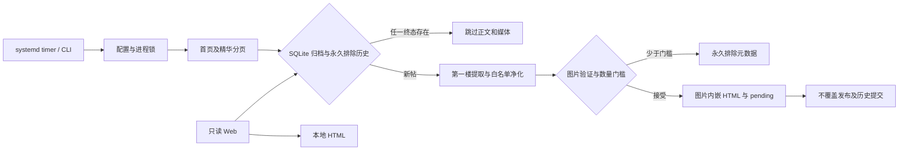

# 单脚本架构

生产代码全部在 `discuz_archive.py`，仅依赖 Python 3.11+ 标准库；配置为 TOML，不打包构建，无编译产物。测试与原型独立于生产入口。

## 模块职责

- `Config`：相对路径以配置目录为基准，限制请求参数及简单广告选择器。
- `Client`：真实 urllib HTTP 会话、Cookie 域隔离、限速、有限重试、robots 检查、响应体上限；不执行页面脚本或绕过验证。
- `Document` / `Node`：标准库 HTMLParser 构建受深度限制的树；不尝试实现任意 CSS 引擎。
- URL 与分页函数：支持 classic、X 和常见伪静态链接。精华依据行内标记或服务器渲染的活动筛选状态；stock 精华页会隐藏图标。无图标置顶通过同板块普通列表另行核验，未知置顶不归档并报告未完整。
- `Cleaner` / `extract_post`：仅第一楼，标签/属性白名单、去交互及广告、原字节图片内嵌；启用 min_images 后隔离单图失败，按不同成功图片源数量决定接受或永久排除，受限图片不请求。格式魔数与基本完整性校验不等同于完整图片解码。
- `Store`：SQLite 成功/永久排除双终态、输出身份、不可覆盖发布、pending 恢复及 v1→v2 事务迁移。契约详见 `DATABASE.md`。
- Web：标准库只读服务、分页列表与按记录 ID 阅读，文件流式响应；没有用户输入的抓取接口。
- systemd：独立日常 oneshot、timer 与可选阅读 service；只有 install/uninstall 修改系统状态。

## 读写及诊断

Web 页面不执行源站请求，不更新归档，不重算内容。只读 SQLite 连接按请求关闭；归档 HTML 直接从本地流式发送。默认回环监听，远程绑定需要 token 文件，Basic 认证用户名 `archive`；TLS 交由反向代理。

`/api/debug/state` 只返回归档、永久排除、pending 数量、版本及最后一次运行计数，带五秒缓存与互斥，不输出源站 URL、Cookie 或私有路径。`--check` 只读验证完整历史和文件摘要，不做补抓。永久排除不视作运行错误，未知模板/整页临时网络问题仍保持可重试错误。

日志为 JSON 行，含 UTC 时间、级别、trace；抓取关键事件记录 tid、fid、字节数、耗时和失败阶段。DEBUG 通过配置启用，默认 INFO。HTTP 错误只记状态，不输出带参数的完整请求地址。

## PWA 与离线

Manifest、SVG 图标、注册脚本及 Service Worker 都嵌在 Python 中按路由提供，无需前端构建。Service Worker 只缓存中性的离线提示与图标，访问失败时提供离线提示，不缓存受鉴权的帖文和列表。单文件归档本身可独立离线阅读，不依赖服务。

## 外部实测及资料

2026-11-03：普通数码论坛首页真实 HTTP 200，并发现伪静态板块链接。精华页探测发现 UTF-8 页面的旧脚本注释混入 GBK 字节；已实现只剔除本来不归档的脚本/样式/注释后严格解码，正文仍拒绝无效编码。修复 stock 图标隐藏后，真实精华页活动状态确认成功，识别出 4 个候选；首帖附件权限不足，被正确拒绝为完整存档。线上完整提取验证结果见特性 TASKS，不以本地 fixture 代替线上证据。

官方模板细节：[精华筛选活动标签及图标条件](https://github.com/Discuz-X/DiscuzX/blob/Common/template/default/forum/forumdisplay_list.htm)、[精华等级 SQL](https://github.com/Discuz-X/DiscuzX/blob/Common/source/class/table/table_forum_thread.php#L754)。

参考官方资料：[HTMLParser](https://docs.python.org/3.11/library/html.parser.html)、[SQLite](https://docs.python.org/3.11/library/sqlite3.html)、[systemd service](https://www.freedesktop.org/software/systemd/man/latest/systemd.service.html)、[systemd timer](https://www.freedesktop.org/software/systemd/man/latest/systemd.timer.html)。
